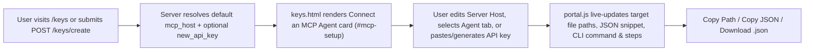

# Implementation Plan: Web Portal MCP Client Installation Configurator (`/keys`)

## Goal

Add an interactive **MCP Client Setup** configurator to the `/keys` web portal page ([`src/gosmart_dictionary_service/web/templates/keys.html`](./src/gosmart_dictionary_service/web/templates/keys.html)) so authenticated users can generate or supply their `gs_dict_...` API key, type or confirm the server hostname, choose their AI coding agent, see the **exact target file path(s)** where the configuration belongs, and **Copy JSON** or **Download JSON** alongside concise agent-specific installation steps.

---

## Confirmed Design Decisions

| Area | Selected Approach |
| :--- | :--- |
| **Placement on `/web`** | Integrated directly on **`/keys`** alongside API key generation, so newly generated keys immediately populate the MCP JSON snippet without extra navigation; also referenced on `/` (`home.html`) under card **2. Generate API Keys & Connect MCP**. |
| **API Key Storage & Injection** | Preserve one-way SHA-256 `secret_hash` storage on Neo4j `:Authenticator` nodes. When a key is created via `POST /keys/create` (main form or 1-click **Generate MCP Key & Populate** button), `new_api_key` is automatically injected into the MCP snippet. On subsequent `GET /keys` visits, users can paste an existing `gs_dict_...` key into a browser-memory-only input or click 1-click generate (showing `<YOUR_GOSMART_API_KEY>` until populated). |
| **Server Hostname Input** | Editable **Server Host / Base URL** input pre-filled with the active server origin (`PUBLIC_BASE_URL` when configured for an external host, otherwise `X-Forwarded-Proto`/`X-Forwarded-Host` or `request.base_url`). Normalizes bare hostnames (`dict.gosmart.health` → `https://dict.gosmart.health/mcp`), loopback hosts (`localhost:8081` → `http://localhost:8081/mcp`), and full URLs seamlessly. |
| **Supported Agent Profiles** | **5 profiles covering all 4 requested agent families** (since Antigravity and Gemini CLI use incompatible URL keys, and Claude Code vs. Claude Desktop use different transports): 1. **Cursor** (`url` + `headers`) 2. **Claude Code** (`type: "http"` + `url` + `headers` + optional `claude mcp add` command) 3. **Claude Desktop** (`npx -y mcp-remote` bridge with `env` + `--header`) 4. **Gemini CLI** (`httpUrl` + `headers` + optional `gemini mcp add` command) 5. **Antigravity** (`serverUrl` + `headers`) |
| **Target File Path Guidance** | Dedicated **Where to Save Configuration** callout per agent displaying labeled **Global (User)** and **Project (Workspace)** file paths (including macOS/Linux and Windows paths where they differ), each paired with a 1-click **Copy Path** button and guidance on merging `"gosmart-dictionary"` into an existing `"mcpServers"` object vs. saving as a new file. |
| **Copy JSON & Download JSON** | Action toolbar on the JSON block with **both**: 1. **`Copy JSON`** button (`navigator.clipboard` with `"Copied!"` feedback) 2. **`Download <filename>`** button that downloads the live JSON snippet with the exact canonical filename for the selected agent (`mcp.json`, `.mcp.json`, `claude_desktop_config.json`, `settings.json`, or `mcp_config.json`) via client-side `Blob` download (preserving any freshly generated or pasted API key purely in browser memory), backed by a server-side `GET /keys/mcp-config.json?agent=...&mcp_host=...` attachment fallback when JavaScript is disabled. |
| **Progressive Enhancement** | Server-side rendering in `web/router.py` (`GET /keys`, `POST /keys/create`, and `GET /keys/mcp-config.json`) paired with instant live client-side updates, clipboard copy, and `Blob` file download in `web/static/portal.js`. |

---

## Agent MCP Configuration Schemas, Target Paths & Download Filenames

All profiles register the server alias `"gosmart-dictionary"` (hyphenated, no underscores—required by Gemini CLI tool-name parsing and compatible across all clients) and authenticate with `X-API-Key`.

| Agent Option | Download Filename | Where to Put the File (Labeled Paths Displayed in UI) | JSON Schema Structure | Notes / Verification |
| :--- | :--- | :--- | :--- | :--- |
| **`cursor`** *(Cursor)* | `mcp.json` | • **Project (workspace):** `<project>/.cursor/mcp.json` • **Global (macOS / Linux):** `~/.cursor/mcp.json` • **Global (Windows):** `%USERPROFILE%\.cursor\mcp.json` | `{"mcpServers": {"gosmart-dictionary": {"url": "<endpoint>", "headers": {"X-API-Key": "<key>"}}}}` | Native Streamable HTTP. Verify green status dot under **Cursor Settings → Tools & MCP**. |
| **`claude-code`** *(Claude Code)* | `.mcp.json` | • **Project (shared/team):** `<project>/.mcp.json` • **Global (macOS / Linux):** `~/.claude.json` • **Global (Windows):** `%USERPROFILE%\.claude.json` | `{"mcpServers": {"gosmart-dictionary": {"type": "http", "url": "<endpoint>", "headers": {"X-API-Key": "<key>"}}}}` | Requires `"type": "http"`. Also shows copyable `claude mcp add --transport http ...` CLI command; verify with `/mcp`. |
| **`claude-desktop`** *(Claude Desktop)* | `claude_desktop_config.json` | • **macOS:** `~/Library/Application Support/Claude/claude_desktop_config.json` • **Windows:** `%APPDATA%\Claude\claude_desktop_config.json` • **Linux:** `~/.config/Claude/claude_desktop_config.json` | `{"mcpServers": {"gosmart-dictionary": {"command": "npx", "args": ["-y", "mcp-remote", "<endpoint>", "--header", "X-API-Key:${GOSMART_API_KEY}"], "env": {"GOSMART_API_KEY": "<key>"}}}}` | Uses `mcp-remote` (`Node.js 18+`) because `claude_desktop_config.json` only accepts `stdio` entries for static API-key headers. Uses no space after `:` in `--header` for Windows/macOS arg safety. |
| **`gemini`** *(Gemini CLI)* | `settings.json` | • **Project (workspace):** `<project>/.gemini/settings.json` • **Global (macOS / Linux):** `~/.gemini/settings.json` • **Global (Windows):** `%USERPROFILE%\.gemini\settings.json` | `{"mcpServers": {"gosmart-dictionary": {"httpUrl": "<endpoint>", "headers": {"X-API-Key": "<key>"}}}}` | Uses **`"httpUrl"`** (`"url"` is reserved for legacy SSE in Gemini CLI). Also shows copyable `gemini mcp add --transport http ...` command; verify with `/mcp`. |
| **`antigravity`** *(Antigravity)* | `mcp_config.json` | • **Workspace:** `<workspace>/.agents/mcp_config.json` • **Global (macOS / Linux):** `~/.gemini/config/mcp_config.json` • **Global (Windows):** `%USERPROFILE%\.gemini\config\mcp_config.json` | `{"mcpServers": {"gosmart-dictionary": {"serverUrl": "<endpoint>", "headers": {"X-API-Key": "<key>"}}}}` | Uses **`"serverUrl"`** (Antigravity does **not** support Gemini CLI's `"httpUrl"`). Can also be opened via **MCP Servers → Manage MCP Servers → View raw config**. |

---

## UX & Data Flow

---

## Detailed Implementation Steps

### 1. Server-Side Host Normalization, Guide Builder & Download Route (`src/gosmart_dictionary_service/web/router.py`)

- Add pure helper functions in `web/router.py`:
  - `_resolve_default_server_origin(request: Request) -> str`:
    - Inspects `X-Forwarded-Proto` / `X-Forwarded-Host` when present, falling back to `str(request.base_url).rstrip("/")`, or `settings.PUBLIC_BASE_URL` if explicitly configured to a non-default external URL.
  - `normalize_mcp_endpoint_url(raw_host: Optional[str], default_origin: str, mount_path: str = "/mcp") -> Tuple[str, str]`:
    - Cleans whitespace, strips trailing slashes and any duplicate `/mcp` or `/mcp-sse` suffix so pasting either `dict.gosmart.health`, `http://127.0.0.1:8081`, or `https://dict.gosmart.health/mcp` produces a clean `(normalized_origin, full_mcp_url)`.
    - Automatically prepends `http://` for loopback/local hosts (`localhost`, `127.0.0.1`, `[::1]`, `*.local`) and `https://` for remote hostnames when no scheme is provided.
  - `build_mcp_client_guide(*, agent: Optional[str], raw_host: Optional[str], default_origin: str, api_key: Optional[str], mount_path: str = "/mcp") -> Dict[str, Any]`:
    - Validates `agent` against `("cursor", "claude-code", "claude-desktop", "gemini", "antigravity")` (defaulting to `"cursor"`, and mapping alias `"claude"` → `"claude-code"`).
    - Substitutes `api_key` when non-empty or `"<YOUR_GOSMART_API_KEY>"` with `has_real_key: bool` metadata.
    - Returns:
      - `json_config` (`json.dumps(..., indent=2)`)
      - `download_filename` (exact per-agent filename: `mcp.json`, `.mcp.json`, `claude_desktop_config.json`, `settings.json`, `mcp_config.json`)
      - `config_locations`: structured list of `{scope_label, path, copy_path}` entries (covering Project/Workspace + Global macOS/Linux/Windows paths)
      - `merge_hint`: clear note explaining whether to save directly or merge `"gosmart-dictionary"` into an existing `"mcpServers"` object (especially important for `~/.claude.json` and `~/.gemini/settings.json` which hold other settings)
      - `steps`, optional `cli_command`, `endpoint_url`, `normalized_origin`, and agent tab metadata.
- Update `GET /keys` (`keys_page`) and `POST /keys/create` (`keys_create_submit`):
  - Accept optional `agent` and `mcp_host` query/form parameters so selections persist across key creation and non-JS form submissions.
  - When `POST /keys/create` succeeds, pass `new_raw_key` directly into `build_mcp_client_guide(...)` so the rendered MCP JSON (and immediate client-side Copy/Download) contains the newly generated key.
- Add `GET /keys/mcp-config.json` (`keys_download_mcp_config`):
  - Authenticated download fallback returning `Response(content=guide["json_config"] + "\n", media_type="application/json")` with `Content-Disposition: attachment; filename="<download_filename>"` (never accepting or exposing secrets in query strings; client-side JS upgrades the link to download the live in-memory JSON `Blob` including any newly generated or pasted API key).

### 2. Portal UI Updates (`src/gosmart_dictionary_service/web/templates/keys.html` & `home.html`)

- In `keys.html`:
  - Add a jump link (`Configure MCP Client ↓`) inside the yellow `new_api_key` banner when a key is freshly generated.
  - Add `<section class="card" id="mcp-setup">` (**Connect an MCP Agent**) between the **API Keys / Generate a New API Key** card and **Your API Keys** table:
    - **Agent Kind Selector**: Accessible segmented tab buttons (`Cursor`, `Claude Code`, `Claude Desktop`, `Gemini CLI`, `Antigravity`) backed by a GET form fallback for zero-JS compatibility.
    - **Server Host / Base URL Input** (`id="mcp-server-host"`): Pre-filled with `mcp_guide.host_input`, showing the resolved Streamable HTTP endpoint pill (`<origin>/mcp`).
    - **API Key Input & 1-Click Generator**:
      - When `new_api_key` is present: pre-filled with `new_api_key` and badged `Populated with newly generated key ({{ new_api_key_name }})`.
      - When `new_api_key` is absent: allows pasting an existing `gs_dict_...` key (client-side only, `autocomplete="off"`) **or** clicking a compact **Generate New MCP Key** POST form button (`POST /keys/create` with `name="MCP Client"`, preserving `agent` and `mcp_host`).
    - **Where to Put This File (`#mcp-config-locations`)**:
      - Structured list/table showing each target scope (`Project / Workspace`, `Global (macOS / Linux)`, `Global (Windows)`) with monospace file path and a **`Copy Path`** button (`data-copy-text="..."`), plus the per-agent merge/placement hint (`#mcp-merge-hint`).
    - **JSON Configuration Toolbar & Code Block**:
      - Header bar displaying the canonical filename badge (`e.g. ~/.cursor/mcp.json · mcp.json`) alongside **two primary actions**:
        1. **`Copy JSON`** button (`data-copy-target="mcp-config-json"`)
        2. **`Download <filename>`** link/button (`id="mcp-download-btn"`, `href="/keys/mcp-config.json?..."`, `data-download-filename="{{ mcp_guide.download_filename }}"`)
      - Dark `<pre class="code-block"><code id="mcp-config-json">...</code></pre>`.
    - **Short Setup Instructions**: Concise 2–3 step numbered list (`id="mcp-setup-steps"`), optional copyable CLI one-liner for Claude Code / Gemini CLI, and a brief note reminding reverse-proxy deployments to include external hostnames in `GOSMART_DS_PUBLIC_BASE_URL` or `GOSMART_DS_MCP_ALLOWED_HOSTS`.
- In `home.html`:
  - Update card #2 copy/link text slightly to highlight one-click MCP client JSON copy/download on `/keys#mcp-setup`.

### 3. Progressive-Enhancement Live Builder & JSON Downloader (`src/gosmart_dictionary_service/web/static/portal.js` & `style.css`)

- Add `initMcpSetup()` in `portal.js`:
  - Mirrors the exact host normalization and 5-agent JSON, target file path locations, download filenames, CLI commands, and instruction builders on the client side.
  - Updates `#mcp-config-json`, `#mcp-resolved-url`, `#mcp-config-locations`, `#mcp-merge-hint`, `#mcp-download-btn` label/filename/fallback `href`, `#mcp-setup-steps`, `#mcp-cli-wrap`, and hidden `agent`/`mcp_host` inputs on the 1-click key generation form whenever the user switches agent tabs, edits the server host, or types/pastes an API key.
  - Attaches a click handler on `#mcp-download-btn` that creates a `Blob([jsonText + "\n"], { type: "application/json;charset=utf-8" })` and triggers a clean browser download named exactly after the selected agent's config file (`mcp.json`, `.mcp.json`, `claude_desktop_config.json`, `settings.json`, or `mcp_config.json`), including the live API key in memory without transmitting secrets over the network.
- Add clean, compact styling in `style.css` for `.mcp-agent-tabs`, `.mcp-agent-tab`, `.mcp-locations-box`, `.mcp-location-row`, `.mcp-code-header`, and `.mcp-steps-list`.

### 4. Documentation Updates (`README.md` & `docs/zensical/docs/getting-started/index.md`)

- Per `AGENTS.md` §1, update `README.md` and `docs/zensical/docs/getting-started/index.md` to document the `/keys` **Connect an MCP Agent** configurator (target file paths, Copy JSON, Download JSON, and per-agent schema differences across Cursor, Claude Code, Claude Desktop, Gemini CLI, and Antigravity).

---

## Verification & Testing Plan

1. **Modular Unit Tests (`tests/unit/test_web_portal.py`)**:
   - `test_mcp_url_normalization_and_agent_guides`: Verify bare hostnames (`dict.gosmart.health` → `https://dict.gosmart.health/mcp`), loopback (`127.0.0.1:8081` → `http://127.0.0.1:8081/mcp`), and full URLs (`https://dict.gosmart.health/mcp/` → `https://dict.gosmart.health/mcp`), plus valid JSON schemas, target file paths, and canonical download filenames for all 5 agents (`cursor`, `claude-code`, `claude-desktop`, `gemini`, `antigravity`).
   - `test_keys_page_mcp_configurator_paths_download_and_one_time_key_injection`:
     - Verify `GET /keys?agent=antigravity&mcp_host=dict.gosmart.health` renders `"serverUrl": "https://dict.gosmart.health/mcp"`, displays target paths (`~/.gemini/config/mcp_config.json` and `<workspace>/.agents/mcp_config.json`), and renders both **Copy JSON** and **Download `mcp_config.json`** controls.
     - Verify `POST /keys/create` with `agent=gemini` & `mcp_host=dict.gosmart.health` returns HTTP `201` with the newly minted `gs_dict_...` key injected directly into `"httpUrl": "https://dict.gosmart.health/mcp"` JSON alongside `~/.gemini/settings.json` path guidance.
     - Verify `GET /keys/mcp-config.json?agent=cursor&mcp_host=dict.gosmart.health` returns `application/json` with `Content-Disposition: attachment; filename="mcp.json"` and valid parseable JSON (and redirects unauthenticated requests to `/login`).
     - Verify subsequent `GET /keys` does **not** expose any stored key secret in HTML.
2. **Code Quality & IDE Inspections (`AGENTS.md` §2)**:
   - Run `uv run ruff check .` and `uv run ruff format --check .`.
   - Run `uv run pytest`.
   - Run PyCharm `lint_files` (`min_severity="strong_warning"`) on all modified files.
