# Implementation Plan: Web Portal Search Loading Indicator & Progressive Status (`/explore` & `/chat`)

## Goal

Improve user responsiveness and feedback in the server-rendered `/web` portal (`/explore` and `/chat`) while NLU parsing, Neo4j hybrid/graph search, and AI inference are running:

1. **Disable submit controls & show a waiting spinner icon** immediately when a search or chat query starts, preventing duplicate submissions and clearly indicating active work.
2. **Display progressive status text ("what it is doing")** next to an animated waiting icon (`role="status" aria-live="polite"`) reflecting the active search scope and pipeline phases.
3. **Preserve 100% progressive enhancement**: zero new backend endpoints, full standard HTML GET/POST fallback when JavaScript is disabled, and clean `pageshow` (bfcache) restoration on browser Back/Forward navigation.

---

## Confirmed Design Decisions

| Area | Selected Approach |
| :--- | :--- |
| **Progress Mechanism** | **Lightweight client-side progress** in `portal.js` & `style.css` (disable button + animated waiting spinner + timed staged status text; no new backend endpoints; full no-JS fallback). |
| **Target Pages** | **Both `/explore` and `/chat`**: `/explore` Search bar + entity Drill Down links, plus matching spinner and staged status messages on `/chat` Send. |
| **Form Serialization Safety** | Only disable the submit button (`#explore-search-btn`, which has no `name` attribute) on `/explore` GET submit — never disable `<input name="q">` or `<select name="scope">` so browser GET query serialization remains intact. |
| **Browser Back/Forward Safety** | Listen for `window` `pageshow` events to stop timers, restore button labels/enabled state, and hide status banners if a page is restored from bfcache. |
| **Accessibility** | Use `role="status"`, `aria-live="polite"`, `aria-busy="true"`, `aria-hidden="true"` on decorative spinners, and respect `@media (prefers-reduced-motion: reduce)`. |

---

## User Flow

```mermaid
flowchart LR
    A["User clicks Search (/explore) or Send (/chat)"] --> B["Disable button + show spinner icon"]
    B --> C["Show inline status bar with spinner"]
    C --> D["Stage 1 (0ms): Parsing query with Clinical NLU..."]
    D --> E["Stage 2 (~900ms): Searching Neo4j graph & embeddings..."]
    E --> F["Stage 3 (~2500ms): Ranking results / Generating AI reply..."]
    F --> G["Page navigates (/explore) or JSON renders (/chat)"]
    G --> H["Reset button & hide status (also on bfcache pageshow)"]
```



---

## Detailed Implementation Steps

### 1. Stylesheet (`src/gosmart_dictionary_service/web/static/style.css`)

- Add explicit disabled button styling (`.btn:disabled`, `.btn[aria-disabled="true"]`) with reduced opacity and `cursor: not-allowed` so disabled Search/Send buttons look unmistakably inactive.
- Add a pure-CSS circular waiting icon (`.loading-spinner`, `.loading-spinner-sm`, `.loading-spinner-light`) animated via `@keyframes gosmart-spin`, with a `@media (prefers-reduced-motion: reduce)` fallback.
- Add `.search-status-bar` (light surface banner directly below the `/explore` search bar with spinner + status text; hidden when `[hidden]` attribute is present).
- Add `.chat-status-indicator` inline flex layout so the spinner aligns cleanly beside `#chat-status` text on `/chat`.

### 2. HTML Templates (`explore.html` & `chat.html`)

- **[`src/gosmart_dictionary_service/web/templates/explore.html`](src/gosmart_dictionary_service/web/templates/explore.html)**:
  - Add IDs to the search form (`id="explore-search-form"`), input (`id="explore-query"`), scope selector (`id="explore-scope"`), and submit button (`id="explore-search-btn"` with `<span class="btn-label">Search</span>`).
  - Add an inline live status bar right below the `<form>`:
    ```html
    <div id="explore-status" class="search-status-bar" role="status" aria-live="polite" hidden>
      <span class="loading-spinner loading-spinner-sm" aria-hidden="true"></span>
      <span id="explore-status-text"></span>
    </div>
    ```
- **[`src/gosmart_dictionary_service/web/templates/chat.html`](src/gosmart_dictionary_service/web/templates/chat.html)**:
  - Add `id="chat-submit-btn"` with `<span class="btn-label">Send</span>` to the chat submit button.
  - Add `class="muted chat-status-indicator"` and `role="status"` to `#chat-status` so it renders the waiting spinner icon beside staged progress text.

### 3. Progressive-Enhancement Script (`src/gosmart_dictionary_service/web/static/portal.js`)

- Decouple `/explore` and `/chat` initialization into separate `initExploreSearch()` and `initChatForm()` functions so `/explore` handlers run cleanly when `#chat-form` is not present on the page (fixing the current early `return` on line 42).
- Add reusable helpers:
  - `scopeLabel(scopeValue)`: maps `clinical` → `"Clinical Terminologies"`, `dicom` → `"DICOM Standard"`, `auto` → `"Clinical & DICOM"`.
  - `setButtonLoading(btn, isLoading, loadingLabel)`: stores the original button text, toggles `disabled` & `aria-busy`, and renders the waiting spinner icon + loading text inside the button (or restores original text when finished).
  - `createStageTicker(stages, onUpdate)`: schedules progressive status updates with clean cancellation via `.stop()`.
- **Explorer (`/explore`) behavior**:
  - On `#explore-search-form` submit: guard against duplicate submits, disable `#explore-search-btn` with spinner + `"Searching…"`, reveal `#explore-status`, and progress through:
    1. `"Parsing query with Clinical NLU…"`
    2. `"Searching Neo4j <scope> graph & embeddings…"`
    3. `"Ranking matches and assembling results…"`
  - On clicking a same-tab drill-down link (`a.drilldown-link` or `a[href^="/explore?"]` without modifier keys/middle-click): disable `#explore-search-btn` (`"Loading…"`) and show `#explore-status` with `"Inspecting entity & traversing Neo4j ontology neighborhood…"`.
  - On `window` `pageshow`: cancel active timers, reset `#explore-search-btn`, hide `#explore-status`, and clear submission guard.
- **AI Chat (`/chat`) behavior**:
  - Upgrade existing AJAX submit handler to use `setButtonLoading(submitBtn, true, ...)` and render spinner + staged status updates in `#chat-status`:
    - Grounded (`include_context` checked):
      1. `"Parsing query with Clinical NLU…"`
      2. `"Searching Neo4j <scope> dictionary…"` (or `"... & traversing related concepts…"` when `include_related` is checked)
      3. `"Generating grounded response with AI model…"`
    - Ungrounded (`include_context` unchecked):
      1. `"Querying AI model…"`
  - In `.finally(...)`: stop stage ticker, clear `#chat-status`, restore `#chat-submit-btn`, and refocus `#chat-message`.

### 4. Automated Verification & Quality Gate

- Add modular unit test in [`tests/unit/test_web_portal.py`](tests/unit/test_web_portal.py) asserting:
  - `/explore` HTML contains `#explore-search-form`, `#explore-search-btn`, and `#explore-status` (`role="status"`, `aria-live="polite"`, `hidden`).
  - `/chat` HTML contains `#chat-submit-btn` and `#chat-status` (`role="status"`).
  - `/static/style.css` serves `.loading-spinner`, `@keyframes gosmart-spin`, `.search-status-bar`, and `.btn:disabled`.
  - `/static/portal.js` serves `initExploreSearch`, `setButtonLoading`, `createStageTicker`, and `pageshow` reset logic.
- Run:
  - `uv run pytest tests/unit/test_web_portal.py`
  - `uv run pytest tests/unit`
  - `uv run ruff check .`
  - `uv run ruff format --check .`

---

## Files to Modify

| File | Change Summary |
| :--- | :--- |
| `src/gosmart_dictionary_service/web/static/style.css` | Add `.btn:disabled`, `.loading-spinner` keyframes/variants, `.search-status-bar`, `.chat-status-indicator`. |
| `src/gosmart_dictionary_service/web/templates/explore.html` | Add form/button IDs and `#explore-status` live progress bar. |
| `src/gosmart_dictionary_service/web/templates/chat.html` | Add `#chat-submit-btn` and spinner-ready `#chat-status` markup. |
| `src/gosmart_dictionary_service/web/static/portal.js` | Refactor into `initExploreSearch()` & `initChatForm()` with button spinner, staged status messages, drill-down loading feedback, and `pageshow` reset. |
| `tests/unit/test_web_portal.py` | Add unit assertions covering the new HTML hooks, CSS classes, and JS loading helpers. |
