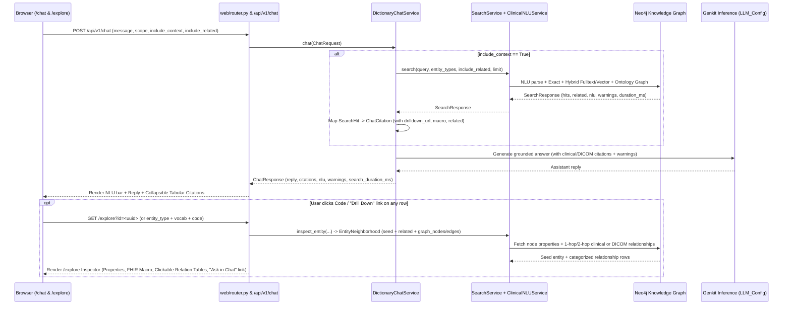

# Implementation Plan: Unified SearchService Grounded AI Chat, Tabular Results & Entity Drill-Down (`/explore`)

## Goal

Upgrade [`DictionaryChatService`](src/gosmart_dictionary_service/service/chat_service.py) and the Web Portal (`/chat` and a new `/explore` drill-down inspector) to leverage the full unified [`SearchService`](src/gosmart_dictionary_service/service/search_service.py) pipeline instead of the legacy DICOM-only regex/fulltext/vector queries.

This delivers:
1. **Unified Natural-Language Grounding** across **Clinical Terminologies** (SNOMED CT, LOINC, ICD-10-CM, UCUM) and **DICOM Standard** entities (`DicomElement`, `DicomCIOD`, `DicomModule`, `DicomMacro`, `DicomSOPClass`, `DicomConfidentialityProfile`).
2. **Collapsible Tabular Grounded Results** under assistant replies (open by default on the latest turn so multi-turn conversations stay tidy), featuring NLU intent/rewrite summary, warning callouts, FHIR `system|code|display` macro copy, and row-level actions.
3. **Dual Navigational Drill-Down**:
   - **Dedicated `/explore` Entity Inspector Page** (`/explore?id=...` or `/explore?entity_type=...&vocab=...&code=...`) displaying full properties, FHIR `Coding` / macro blocks, and **grouped relationship tables** where every related row is itself clickable to keep traversing the graph — structured on a clean **Graph Neighborhood (`seed` + `nodes` + `edges`)** data model so an interactive Graph UI canvas (e.g., Cytoscape.js / Force-Graph) can plug directly into `/explore` later without refactoring.
   - **In-Chat Quick Traverse Action (`Ask in Chat`)** on every table row to trigger follow-up ontology queries (`Find related concepts`, `Crosswalk`, or `Explain`) directly in the active conversation.

---

## Confirmed Design Decisions

| Area | Selected Approach |
| :--- | :--- |
| **Retrieval Backend** | Delegate dictionary grounding in `DictionaryChatService` to `SearchService.search()`, auto-routing across Clinical Concepts and DICOM entities via `ClinicalNLUService`. |
| **Search Controls in `/chat`** | Auto-route all schemas by default (`auto`), with a **Scope selector** (`Auto (Clinical + DICOM)`, `Clinical Terms Only`, `DICOM Standard Only`) and an **`Include related concepts`** toggle alongside **`Ground with Neo4j dictionary`**. |
| **Tabular Results in `/chat`** | **Always tabular** when grounded hits exist, wrapped in `
` on the latest assistant reply (collapsible so long chats stay tidy), preceded by a compact NLU summary bar and any non-fatal NLU/schema warnings. |
| **Navigational Drill-Down** | **Both**: (1) Dedicated **`/explore`** Entity Drill-Down page (with grouped, clickable relationship tables + graph-ready neighborhood model for a future Graph UI), and (2) quick **`Ask in Chat`** action button on each row. |
| **Backward Compatibility** | Preserve all existing `ChatCitation` fields (`entity_type`, `identifier`, `name`, `keyword`, `vr`, `vm`, `retired`, `snippet`, `score`, `source`) and `DictionaryChatService(search_fn=...)` hook so existing REST/test callers remain 100% compatible. |

---

## Architecture & Data Flow

---

## Detailed Implementation Steps

### 1. Entity Inspection & Graph-Ready Neighborhood Model (`model/search.py` & `service/search_service.py`)

To power `/explore` cleanly across all searchable labels (`Concept`, `DicomElement`, `DicomCIOD`, `DicomModule`, `DicomMacro`, `DicomSOPClass`, `DicomConfidentialityProfile`) **and** lay the exact data contract needed for a future Graph UI:

1. **Add Graph-Ready Inspection Models in [`src/gosmart_dictionary_service/model/search.py`](src/gosmart_dictionary_service/model/search.py)**:
   - **`GraphNodeView`**: `id`, `label` (`SearchEntityType`), `code`, `display`, `vocabulary: Optional[str]`, `is_seed: bool = False`, `drilldown_url: str`, `properties: Dict[str, Any]`.
   - **`GraphEdgeView`**: `source_id`, `target_id`, `predicate` (`relationship_id`), `category` (`MatchSource`), `direction` (`RelationDirection`), `properties: Dict[str, Any]`.
   - **`EntityNeighborhood`**:
     - `seed: SearchHit` (full canonical `FHIRCoding`, `macro`, `properties`, `related`)
     - `drilldown_url: str`
     - `nodes: List[GraphNodeView]` (seed + neighbor nodes — ready for a future Cytoscape/D3 Graph tab)
     - `edges: List[GraphEdgeView]` (directed edges — ready for a future Graph tab)
   - Helper **`build_drilldown_url(...) -> str`**: produces canonical `/explore?...` relative URLs for any `SearchHit` or `RelatedConceptHit` (e.g., `/explore?id=<uuid>` with fallback query params `entity_type`, `vocab`, `code`).

2. **Add `SearchService.inspect_entity(...)` in [`src/gosmart_dictionary_service/service/search_service.py`](src/gosmart_dictionary_service/service/search_service.py)**:
   - Resolves an entity either by deterministic `node_id` (`id` UUIDv5 indexed lookup across clinical/DICOM labels) **or** by `(entity_type, vocabulary_id, code)` (`lookup_code` / `lookup_dicom` / structure lookup).
   - Populates 1-hop / 2-hop neighborhood edges:
     - **`Concept`**: reuses `find_related_concepts(..., direction=BOTH, include_shared_attributes=True, limit=related_limit)` (`IS_A` parents/children, `MAPS_TO` / `MAPPED_FROM` crosswalks, `REPLACED_BY`, `HAS_ATTRIBUTE`, `SHARED_ATTRIBUTE` siblings).
     - **`DicomElement`**: fetches parent `DicomModule` / `DicomMacro` (`USES_ELEMENT` with `requirement_type` & `path`) and `DicomConfidentialityProfile` (`HAS_CONFIDENTIALITY_PROFILE` with `basic_profile`).
     - **`DicomCIOD`**: fetches implementing `DicomSOPClass` (`IMPLEMENTS_CIOD`), constituent `DicomModule` (`HAS_MODULE` with `usage` & `information_entity`), and `DicomMacro` (`HAS_FUNC_GROUP_MACRO`).
     - **`DicomModule` / `DicomMacro`**: fetches parent `DicomCIOD` (`HAS_MODULE` / `HAS_FUNC_GROUP_MACRO`) and constituent `DicomElement` attributes (`USES_ELEMENT` with `tag`, `requirement_type`, `path`).
     - **`DicomSOPClass` / `DicomConfidentialityProfile`**: fetches linked `DicomCIOD` (`IMPLEMENTS_CIOD`) or `DicomElement` (`HAS_CONFIDENTIALITY_PROFILE`).
   - Respects `test_id` isolation (`normalize_test_id(test_id)`).

---

### 2. Chat Service Upgrade (`src/gosmart_dictionary_service/service/chat_service.py`)

1. **Extend Pydantic Models (100% backward-compatible)**:
   - **`ChatSearchScope = Literal["auto", "clinical", "dicom"]`**
   - **`ChatRelatedItem`**: `id`, `entity_type`, `identifier`, `display`, `vocabulary: Optional[str]`, `relation: str`, `relationship_id: str`, `direction: str`, `macro: str`, `drilldown_url: str`.
   - **`ChatCitation`** (keep all existing fields; add optional unified fields):
     - `id: Optional[str] = None` (Neo4j deterministic UUIDv5)
     - `vocabulary: Optional[str] = None` (e.g., `SNOMED`, `LOINC`, `ICD10CM`, `UCUM`)
     - `domain: Optional[str] = None` (e.g., `Condition`, `Measurement`, `Procedure`)
     - `standard_concept: Optional[str] = None`
     - `coding_system: Optional[str] = None`
     - `macro: Optional[str] = None` (`<system>|<code>|<display>`)
     - `match_sources: List[str] = Field(default_factory=list)`
     - `drilldown_url: Optional[str] = None` (`/explore?...`)
     - `related: List[ChatRelatedItem] = Field(default_factory=list)`
   - **`ChatNLUSummary`**:
     - `intent: str`, `provider: str`, `normalized_query: str`, `rewritten_query: Optional[str] = None`, `synthesized_phrases: List[str]`, `extracted_codes: List[str]`, `inferred_vocabularies: List[str]`, `target_vocabularies: List[str]`.
   - **`ChatRequest`**:
     - Add `scope: ChatSearchScope = "auto"`
     - Add `include_related: bool = False`
     - Add `test_id: Optional[str] = None`
   - **`ChatResponse`**:
     - Add `nlu: Optional[ChatNLUSummary] = None`
     - Add `warnings: List[str] = Field(default_factory=list)`
     - Add `search_duration_ms: Optional[float] = None`

2. **Delegate Grounding to `SearchService`**:
   - Accept `search_service: Optional[SearchService] = None` in `DictionaryChatService.__init__` (creating a default `SearchService` bound to `self.client`, `self.embedding_service`, and `self._settings` when not injected, while preserving custom `search_fn` injection for existing unit tests).
   - Map `scope`: `"auto"` -> `None` (NLU auto-routing), `"clinical"` -> `["clinical"]`, `"dicom"` -> `["dicom"]`.
   - Auto-enable `include_related=True` when `request.include_related` is `True` or when NLU detects ontology intents.
   - Convert `SearchHit` -> `ChatCitation` via `search_hit_to_citation(hit)` with `drilldown_url`, `macro`, clinical/DICOM metadata, and `related` items.
   - Update `SYSTEM_PROMPT`, `format_context_block`, and `build_prompt` to include Clinical Terminology fields (`Vocabulary`, `Code`, `Display`, `Domain`, `FHIR Macro`), DICOM fields (`Tag`, `Keyword`, `VR`, `VM`), attached `related` concepts, and `SearchResponse.warnings` guardrails.

---

### 3. Web Portal & REST Routes (`web/router.py` & `api/v1/endpoints/`)

1. **`web/router.py` — `/chat` Updates**:
   - `GET /chat`: support optional `?q=...` query parameter (so clicking **"Ask in Chat"** from `/explore` pre-populates the chat input!), plus default `selected_scope="auto"`, `include_context_checked=True`, `include_related_checked=False`.
   - `POST /chat`: accept `scope: str = Form(default="auto")` and `include_related: Optional[str] = Form(default=None)`, forward to `ChatRequest`, and pass `nlu`, `warnings`, `search_duration_ms`, and `citations` to `chat.html` for full server-rendered parity when JS is disabled.
2. **`web/router.py` — New `GET /explore` Drill-Down Route**:
   - Protected by session auth (`if not current_user: return _redirect_to_login(full_explore_path)`), matching `/chat` and `/keys`.
   - Accepts `id: Optional[str] = Query(None)`, `entity_type: Optional[str] = Query(None)`, `vocab: Optional[str] = Query(None)`, `code: Optional[str] = Query(None)`.
   - Calls `search_service.inspect_entity(...)` and renders [`explore.html`](src/gosmart_dictionary_service/web/templates/explore.html) (returns 404 alert state cleanly if the requested node does not exist).
   - Also add `"Explore"` link in [`base.html`](src/gosmart_dictionary_service/web/templates/base.html) navigation (or highlight when `active_page == 'explore'`) with a quick search/jump bar on `/explore` when visited directly without query parameters.

---

### 4. Web UI Templates, Progressive JS & Styles (`chat.html`, `explore.html`, `portal.js`, `style.css`)

1. **Tabular Grounded Results in [`chat.html`](src/gosmart_dictionary_service/web/templates/chat.html) & [`portal.js`](src/gosmart_dictionary_service/web/static/portal.js)**:
   - **Controls Bar**: Scope `<select>` (`Auto (Clinical + DICOM)`, `Clinical Terms Only`, `DICOM Standard Only`), `Ground with Neo4j dictionary` checkbox, and `Include related concepts` checkbox, plus clickable quick-prompt chips in the empty state.
   - **Assistant Message Footer**:
     1. **Compact NLU Summary Bar** (`.chat-nlu-bar`): Intent badge (`SEARCH`, `EXACT LOOKUP`, `CROSSWALK`, `RELATED LOOKUP`, `EXPAND SUBTYPES`), extracted codes, rewritten query, and search latency (`ms`).
     2. **Warning Callout** (`.chat-warning-box`): Renders any `warnings` (e.g., unloaded coding schemas or unknown codes).
     3. **Collapsible Grounded Results Table** (`
` on the latest turn; older turns auto-collapse when a new reply arrives so long chats stay tidy):
        - `
`: `Grounded Dictionary Results (N)` + quick hint.
        - **Columns**:
          - **`Schema / Type`**: Pill badge (e.g., `LOINC`, `SNOMED`, `ICD10CM`, `DICOM Tag`, `DICOM Module`)
          - **`Code / Tag`**: Monospace clickable link `<a href="/explore?...">` (e.g., `87279-6`, `(0018,0050)`)
          - **`Display / Name`**: Primary name + truncated description tooltip/subtext + retired/deprecated badge if applicable
          - **`Details`**: Clinical `Domain` + `Standard` (`S`), or DICOM `Keyword` + `VR` / `VM`
          - **`Score`**: Score + match source (`exact`, `hybrid`, `fulltext`, `vector`)
          - **`Actions`**:
            - **`Drill Down`** link (`/explore?...`)
            - **`Ask in Chat`** button (populates/submits follow-up traversal in `/chat`, e.g., *"Show related concepts and crosswalks for LOINC 87279-6"*)
            - **`Copy Macro`** button (copies `system|code|display` to clipboard)
        - If a row has `related` items attached (when `Include related concepts` or `RELATED_LOOKUP` / `CROSSWALK` is used), renders a compact sub-row of clickable `/explore` links for those related concepts.

2. **New Entity Drill-Down Template [`src/gosmart_dictionary_service/web/templates/explore.html`](src/gosmart_dictionary_service/web/templates/explore.html)**:
   - **Breadcrumb / Header**: Back to Chat / Search bar, Entity Type + Vocabulary badge, Display Name, canonical Code/Tag, Status pill (`Active` vs `Retired/Deprecated`), and an **`Ask AI Chat about this entity ->`** button (`/chat?q=...`).
   - **Metadata & Coding Card**:
     - Key-value grid of entity properties (`Vocabulary`, `Domain`, `Concept Class`, `Standard Concept`, `Synonyms`, `Definition` **or** `Tag`, `Keyword`, `VR`, `VM`, `Description`, `Basic Confidentiality Profile`, `CIOD Name`).
     - Copyable **GoSmart Coding Macro** (`<system>|<code>|<display>`) and canonical **FHIR Coding JSON** snippet using `.secret-box` / `[data-copy-target]`.
   - **Grouped Relationship Tables** (each related row has a clickable `/explore?...` link on its Code/Tag to keep traversing the graph + `Copy Macro`):
     - Clinical: *Hierarchy (`IS_A` Parents & Subtypes)*, *Crosswalks & Replacements (`MAPS_TO`, `MAPPED_FROM`, `REPLACED_BY`)*, *Defining Attributes & Shared-Axis Siblings (`HAS_ATTRIBUTE`, `SHARED_ATTRIBUTE`)*.
     - DICOM: *CIOD / SOP Class Usage*, *Module / Macro Membership & Requirement Types (`1`, `1C`, `2`, `3`)*, *Confidentiality Profile Rules*.
   - **Graph-Ready Hook**: Includes a serialized `<script type="application/json" id="entity-graph-data">` (or data attribute) with `nodes` & `edges` counts summarized in the header so a future interactive Graph View tab can mount directly onto `#entity-graph-data` with zero backend changes.

3. **Stylesheet [`src/gosmart_dictionary_service/web/static/style.css`](src/gosmart_dictionary_service/web/static/style.css)**:
   - widen chat container option or keep clean 1040px container so the 6-column table has plenty of breathing room (`max-width: 96%` for `.chat-msg-assistant` when containing a table).
   - Add clean styles for `.chat-options-bar`, `.chat-select`, `.chat-prompt-chips`, `.chat-nlu-bar`, `.chat-warning-box`, `.citation-drawer`, `.citation-table`, `.kv-grid`, and `.explore-header`.

---

### 5. Documentation Updates (`README.md`, `docs/zensical/docs/getting-started/index.md`, `home.html`)

Per `AGENTS.md` Rule 1:
- Update [`home.html`](src/gosmart_dictionary_service/web/templates/home.html) to mention unified Clinical + DICOM AI Chat, tabular citations, and entity drill-down (`/explore`).
- Update [`README.md`](README.md) and [`docs/zensical/docs/getting-started/index.md`](docs/zensical/docs/getting-started/index.md) Web Portal & REST API sections with `/explore` and the upgraded `/chat` / `POST /api/v1/chat` capabilities.

---

## Testing & Verification Plan

Following `AGENTS.md` Rules 2, 3, and 4:

1. **Unit Tests — `SearchService.inspect_entity` (`tests/unit/test_search_service.py`)**:
   - Test `inspect_entity` for `Concept` (with hierarchy/crosswalk edges and `GraphNodeView` / `GraphEdgeView` generation) and `DicomElement` / `DicomModule` (with `USES_ELEMENT` and `HAS_CONFIDENTIALITY_PROFILE` edges), plus `build_drilldown_url`.
2. **Unit Tests — `DictionaryChatService` (`tests/unit/test_chat_service.py`)**:
   - Test `search_hit_to_citation` for Clinical `Concept` (LOINC/SNOMED), `DicomElement`, and `DicomModule`, verifying `drilldown_url`, `macro`, `vocabulary`, `domain`, and `related` mapping.
   - Test `DictionaryChatService.chat()` delegating to `SearchService` across `scope` (`auto`, `clinical`, `dicom`), `include_related`, NLU summary generation, and warning propagation into the LLM prompt.
   - Keep existing `search_fn` and error-handling tests green.
3. **Unit Tests — Web Portal `/chat` & `/explore` (`tests/unit/test_web_portal.py` & `tests/unit/test_auth_api.py`)**:
   - Verify `GET /chat` (including `?q=...` prefill) and `POST /chat` render the NLU summary bar, collapsible tabular citations (`citation-table`), `/explore?...` drill-down links, and `Copy Macro` / `Ask in Chat` actions.
   - Verify `GET /explore` renders full entity metadata, FHIR macro, and clickable related-entity drill-down rows for both Clinical Concepts and DICOM entities (and redirects unauthenticated browsers to `/login?next=/explore...`).
4. **Live Neo4j Integration Test (`tests/integration/test_search_service_neo4j.py`)**:
   - Using isolated `test_id` and cleaning up **only prior `test_id` data before the test** (preserving post-test records for inspection per `AGENTS.md` Rule 4), verify `DictionaryChatService` + `SearchService.inspect_entity` end-to-end against Neo4j.
5. **Quality & Docs Build Gates**:
   - `uv run pytest`
   - `uv run ruff check .`
   - `uv run ruff format --check .`
   - `cd docs/zensical && uv run --group docs zensical build --strict --clean`
