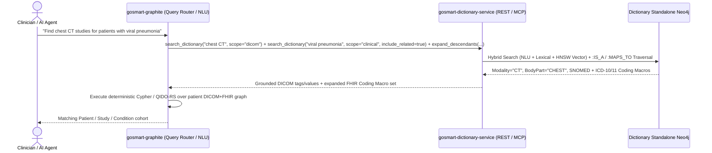
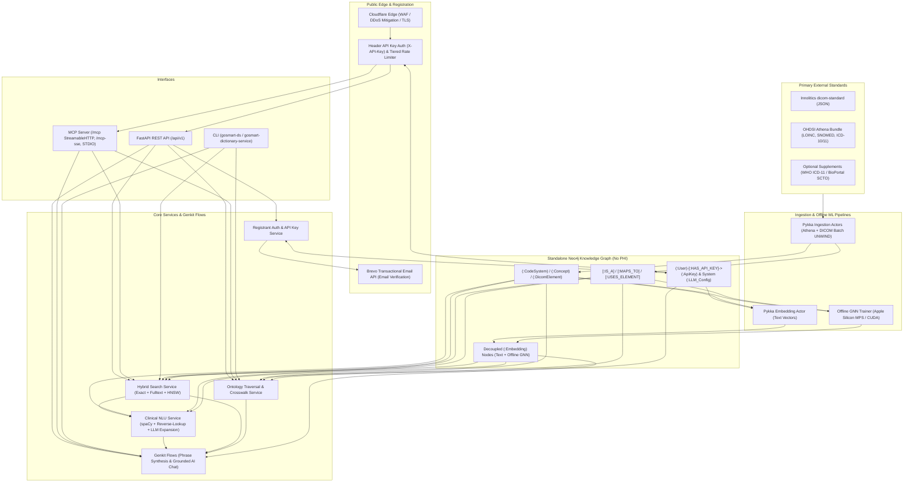

# GoSmart Health Terminology Dictionary and Ontology Graph Service

## 1. Why We Need This Service?

We are now at the point where we can combine **Large Language Models (LLMs)**, **Vector Embeddings**, and **Graph Neural Networks (GNNs)** over a property graph to power a unified terminology dictionary and ontology graph service for the **Gosmart.Health** platform.

Clinical and imaging systems routinely bridge two worlds:

1. **Unstructured / Conversational Intent** — Clinicians, researchers, and AI agents ask questions in natural language (e.g., *"thin-slice chest CT studies with pulmonary embolism"* or *"patients with type 2 diabetes and elevated HbA1c"*).
2. **Strict Standard Identifiers** — Downstream clinical engines require exact, non-hallucinated identifiers: DICOM Tags `(gggg,eeee)` / Keywords / Context Group IDs (CIDs) and canonical FHIR `Coding` tuples (`system|code|display`).

`gosmart-dictionary-service` provides the authoritative **REST API**, **Model Context Protocol (MCP)** server, and **CLI** for natural-language semantic search, deterministic code lookup, cross-vocabulary mapping, and ontology graph traversal across:

- **DICOM Dictionary** (Data Elements, CIODs, Modules, SOP Classes, Context Groups)
- **LOINC** terminology and multi-axial hierarchy
- **SNOMED CT** terminology and polyhierarchical ontology graph
- **ICD-10 / ICD-10-CM** and **ICD-11** classifications and linearization graphs

---

## 2. Proposed Use Cases & Ecosystem Integration

### 2.1 Core Service Use Cases

- **DICOM Tag & Attribute Lookup** — Resolve natural-language imaging descriptions, keywords, or hex tags to canonical DICOM Data Elements (`(gggg,eeee)`, `Keyword`, `VR`, `VM`, retirement status, and participating IOD Modules).
- **LOINC Code Lookup** — Resolve laboratory tests, vital signs, clinical measurements, and radiology study/report codes (`http://loinc.org`).
- **SNOMED CT Concept Lookup** — Resolve clinical findings, disorders, procedures, body structures, and qualifiers (`http://snomed.info/sct`).
- **ICD-10 / ICD-10-CM Code Lookup** — Resolve diagnostic and billing classifications (`http://hl7.org/fhir/sid/icd-10`, `http://hl7.org/fhir/sid/icd-10-cm`).
- **ICD-11 Code Lookup** — Resolve WHO ICD-11 Foundation and Mortality & Morbidity Statistics (MMS) entities (`http://id.who.int/icd/release/11/mms`).
- **Ontology Exploration** — Starting from any resolved node in a supported terminology or ontology graph, traverse ancestors (`:IS_A`), descendants (subsumption), partonomies, clinical defining attributes, and cross-terminology equivalences (`:MAPS_TO`).

### 2.2 Sibling Integration: Query Translation for `gosmart-graphite`

A primary consumer of this service is the sibling project **`gosmart-graphite`** (the Graph-Based Clinical DICOM and FHIR Integrated Server). When `gosmart-graphite` processes natural-language clinical or cohort queries (alongside `gosmart-clinical-nlu` intent/slot extraction and Genkit query routing), `gosmart-dictionary-service` grounds free-text entities into exact graph and protocol predicates:

1. **Natural Language → DICOM Element Resolution**
   - *Example query:* *"Find MR brain series with inversion time around 900 ms and slice thickness <= 1.5 mm"*
   - *Resolution:* Maps *"inversion time"* → `(0018,0082)` `InversionTime` (`VR=DS`) and *"slice thickness"* → `(0018,0050)` `SliceThickness` (`VR=DS`), enabling `gosmart-graphite` to construct valid QIDO-RS, DICOM `C-FIND`, or Neo4j `:Study` / `:Series` / `:Instance` property filters without LLM tag hallucination.
2. **Natural Language → FHIR Terminology & Coding Macro Resolution**
   - `gosmart-graphite` indexes coded fields on FHIR resource nodes (`:Condition.code`, `:Observation.code`, `:DiagnosticReport.code`, `:DiagnosticReport.conclusionCode`, `:Procedure.code`, `:ServiceRequest.code`) using canonical **Coding Macros** (`"<system>|<code>|<display>"` and `"<system>|<code>"`).
   - *Example query:* *"Patients diagnosed with acute pulmonary embolism"*
   - *Resolution:* Resolves candidate concepts in SNOMED CT (`http://snomed.info/sct|59282003|Pulmonary embolism`) and ICD-10-CM (`http://hl7.org/fhir/sid/icd-10-cm|I26.99|...`), emitting ready-to-bind FHIR `Coding` objects and `gosmart-graphite` Coding Macro prefixes.
3. **Subsumption Expansion & Cross-Vocabulary Bridging**
   - Clinical records rarely use a single code: one hospital records SNOMED CT `709044004` (*Chronic kidney disease*), another records a specific stage subtype (`431855005`, *CKD stage 1*), and billing records store ICD-10-CM `N18.1`.
   - Given a root concept, the Ontology Graph / MCP API expands `:IS_A` descendants (to a configurable depth) and follows `:MAPS_TO` cross-walks so `gosmart-graphite` Cypher queries match the complete clinical concept family in a single predicate list.



---

## 3. Architecture & Platform Conventions

To maintain operational consistency across the **Gosmart.Health** ecosystem, `gosmart-dictionary-service` adopts the core architectural patterns established in `gosmart-graphite` while running against a **dedicated standalone Neo4j instance containing zero patient PHI**.

### 3.1 System Overview



### 3.2 Technology Stack

| Concern | Module / Pattern | Notes |
| :--- | :--- | :--- |
| **Runtime & Packaging** | Python `>=3.14`, `uv`, `hatchling` | `src/gosmart_dictionary_service` layout; CPU-only runtime container |
| **Edge & Abuse Protection** | Cloudflare + FastAPI Rate-Limit Middleware | Cloudflare WAF / L3–L7 DDoS protection + per-key `X-API-Key` quotas |
| **Registration & Email** | `argon2-cffi`, `httpx` + **Brevo API** | Email + password registration with Brevo email confirmation |
| **HTTP API** | `fastapi` + `uvicorn[standard]` | Versioned under `/api/v1` |
| **MCP Server** | `mcp` Python SDK (`>=2.3,<3`) | Streamable HTTP (`/mcp`), SSE (`/mcp-sse`), and CLI `STDIO` transports with stateful `MCPSessionContextStore` |
| **CLI** | `argparse` (`__main__.py`) | Entry points: `gosmart-dictionary-service`, `gosmart-ds` (`serve`, `mcp`, `bootstrap`, `ingest-dicom`, `ingest-clinical-terms`) |
| **Graph & Vector Store** | Standalone `neo4j` (`>=6.4`) | Dedicated non-PHI graph + Full-Text (Lucene) + native HNSW Vector Index |
| **Clinical NLU** | `gosmart-clinical-nlu` (spaCy `textcat` + `entity_ruler`) | Trained `find_coding_schema` bundle (`nlu_models/intent_models.zip`) + dynamic DB schema alerts |
| **LLM & Embeddings** | `genkit` (`genkit-google-genai`, `genkit-ollama`) | Dynamic provider resolution via system `:LLM_Config` (`embedding-v1` & `inference-v1`, e.g. `gemma4:e2b`) |
| **Offline GNN Pipeline** | PyTorch + PyTorch Geometric (`train` group) | Offline structural embedding job (runs on Apple M5 MPS or 6 GB CUDA GPU) |
| **Concurrency** | `pykka` Actor Model | Non-blocking bulk terminology ingestion and background batch embedding |
| **Configuration & Logs** | `pydantic-settings` (`GOSMART_DS_*`), `structlog` | `.env` + `tests/.env` resolution; rotating JSON/console logs (`stderr` stream on MCP `stdio`) |
| **Documentation** | `zensical` (`docs` dependency group) | Hosted docs and local live preview under `docs/zensical/` |

### 3.3 Core Architectural Policies

1. **Standalone Non-PHI Neo4j Deployment**
   - Runs on its own dedicated Neo4j instance completely isolated from `gosmart-graphite` patient data. The graph holds only public terminology/ontology entities, `:Embedding` vectors, system `:LLM_Config`, and basic registrant `:User` / `:ApiKey` nodes.
2. **Deterministic UUIDv5 Identity (`id`)**
   - Every graph node and relationship derives its primary `id` deterministically via UUIDv5 under a dedicated DNS namespace (`gosmart.dictionary.graph`) from canonicalized JSON identity keys—uniformly using `{system, code}` across clinical and DICOM code systems (e.g., `{"system": "http://snomed.info/sct", "code": "44054006"}` or `{"system": "http://gosmart.health/terminology/dicom-tag", "code": "00180050"}`).
   - Re-running an ingestor on a new Athena or DICOM release is strictly **idempotent** (`MERGE (c:Concept {id: row.id})`).
3. **`Auditable` Base Entities & Non-Destructive Lifecycle**
   - Graph entities inherit from `AuditableNode` / `AuditableRelation` (`id`, `test_id`, `Action`, `ActedAt`, `ActedBy`, `CreatedAt`, `UpdatedAt`, `ExpiresAt`).
   - Retired DICOM attributes and deprecated clinical codes are **never hard-deleted**—historical clinical studies and FHIR resources still reference them. Instead, their status flags (`is_retired`, `is_deprecated`, `valid_end_date`) are updated, and superseded ontology edges transition to `NOT_<REL_TYPE>` (e.g., `:NOT_IS_A`, `:NOT_MAPS_TO`) while preserving provenance.
4. **Actor Pattern for Long-Running / Blocking I/O**
   - Terminology archives (OHDSI Athena CSVs, multi-million-row relationship tables) and batch vector embedding jobs run inside dedicated Pykka actors (`IngestionActor`, `EmbeddingActor`) so FastAPI and MCP endpoints remain responsive.
5. **Production-Safe Test Isolation (`test_id`)**
   - All test-created nodes and relationships carry a non-empty `test_id`. Tests clean up matching `test_id` records **before** execution (rather than after) so post-test graph state remains inspectable on failure or completion.

### 3.4 Public Access, Brevo Email Registration, API Keys & Cloudflare Protection

Because `gosmart-dictionary-service` contains no PHI, it operates as a **rate-limited public resource** with lightweight self-service registration:

1. **Cloudflare Edge Shielding (DDoS & WAF)**
   - Deployed behind **Cloudflare** (reverse proxy / Cloudflare Tunnel / Authenticated Origin Pulls) for L3–L7 DDoS mitigation, bot/WAF filtering, TLS termination, and coarse IP-level burst throttling before traffic reaches the FastAPI origin.
   - The FastAPI ingress trusts `CF-Connecting-IP` only from verified Cloudflare origin paths so direct-to-origin bypass is blocked.
2. **Simple Email + Password Registration with Brevo Confirmation**
   - Users register with an email address and password (`argon2-cffi` hashed on a `:User` node with `email_verified=False`).
   - The service dispatches a time-limited verification token link via the **Brevo Transactional Email API** (`POST https://api.brevo.com/v3/smtp/email` authenticated via `GOSMART_DS_BREVO_API_KEY`).
   - Upon email confirmation (`email_verified=True`), the registrant can log in with email + password to generate, inspect, rotate, or revoke their API keys (and use Brevo for password-reset emails).
3. **Lightweight Header API Key (`X-API-Key`) & Tiered Quotas**
   - API keys (`gs_dict_<prefix>_<secret>`, stored as a SHA-256 hash on `:ApiKey` nodes linked via `(:User)-[:HAS_API_KEY]->(:ApiKey)`) are passed in the `X-API-Key` request header on REST (`/api/v1/...`) and remote MCP (`StreamableHTTP` `/mcp` and `SSE` `/mcp-sse`) requests.
   - **Public Registrant Tier:** Generous sliding-window quota for deterministic graph/lexical lookups and a stricter token-bucket quota for vector/Genkit-assisted natural-language resolution (`POST .../resolve`), returning standard `429 Too Many Requests` (`Retry-After` / `X-RateLimit-*`) headers when exceeded.
   - **Trusted Platform Tier (`gosmart-graphite`):** Sibling services use an `INTERNAL_SERVICE` tier key with elevated/unmetered throughput.

---

## 4. Knowledge Graph, Vector, and GNN Design

### 4.1 Graph Schema

#### A. DICOM Dictionary Subgraph

- **`(:DicomElement)`**: `id` (UUIDv5 from `{system: "http://gosmart.health/terminology/dicom-tag", code: tag_hex}`), `system_uri` (`"http://gosmart.health/terminology/dicom-tag"`), `tag` (`"(0018,0050)"`), `tag_hex` (`"00180050"` — canonical `code`), `keyword` (`"SliceThickness"`), `name` (`"Slice Thickness"` — canonical `display`), `vr` (`"DS"` — code in `http://gosmart.health/terminology/dicom-vr`), `vm` (`"1"`), `is_retired` (`bool`), `description` (normative/clean text summary), `coding_key`, `coding_macro`.
- **`(:DicomCIOD)`**: Composite IOD definition (e.g., `CT Image IOD`, `MR Image IOD`, `Enhanced SR IOD`).
- **`(:DicomModule)`**: Module definition (e.g., `Patient`, `General Study`, `CT Image`).
- **`(:DicomSOPClass)`**: `sop_class_uid`, `name`, `modality`.
- **`(:DicomContextGroup)`**: DICOM PS3.16 Context Group (`cid`, `name`, `is_extensible`) linking coded concepts (`http://dicom.nema.org/resources/ontology/DCM`, SNOMED CT, LOINC) used in Structured Reporting (SR) and modality protocols.
- **Relationships**:
  - `(:DicomElement)-[:BELONGS_TO_SYSTEM]->(:CodeSystem)` (links to `http://gosmart.health/terminology/dicom-tag`)
  - `(:DicomSOPClass)-[:IMPLEMENTS_CIOD]->(:DicomCIOD)`
  - `(:DicomCIOD)-[:HAS_MODULE {usage, condition}]->(:DicomModule)`
  - `(:DicomModule)-[:USES_ELEMENT {type, description}]->(:DicomElement)` (where `type` is `1`, `1C`, `2`, `2C`, `3`)
  - `(:DicomContextGroup)-[:INCLUDES_CONCEPT]->(:Concept)`

#### B. Clinical Terminology & Ontology Subgraph (OHDSI Athena Canonical Model)

- **`(:CodeSystem)`**:
  - `id` (UUIDv5 from `system_uri`), `vocabulary_id` (`"SNOMED"`, `"LOINC"`, `"ICD10"`, `"ICD10CM"`, `"ICD11"`, `"DCM"`, `"DICOM_TAG"`, `"DICOM_VR"`), `system_uri`, `name`, `version`, `release_date`.
  - Canonical FHIR `system_uri` values are defined in [Section 4.2](#42-terminology-encoding--response-contract).
- **`(:Concept)`**:
  - `id` (UUIDv5 from `{system_uri, code}`), `athena_concept_id` (`Optional[int]`), `system_uri`, `vocabulary_id`, `code`, `display`, `synonyms` (`List[str]`), `definition`, `domain_id` (`Condition`, `Observation`, `Procedure`, `Measurement`, `Spec Anatomic Site`, etc.), `concept_class_id`, `standard_concept` (`"S"`, `"C"`, or `null`), `is_deprecated` (`bool`), `valid_start_date`, `valid_end_date`.
  - Precomputed convenience fields: `coding_key` (`"<system_uri>|<code>"`) and `coding_macro` (`"<system_uri>|<code>|<display>"`) for zero-cost `gosmart-graphite` query generation.
- **Ontology & Mapping Relationships**:
  - `(:Concept)-[:BELONGS_TO_SYSTEM]->(:CodeSystem)`
  - `(:Concept)-[:IS_A]->(:Concept)` — Taxonomic subsumption (`child -> parent` derived from Athena `Is a` / `Subsumes` and native hierarchies), enabling variable-length Cypher hierarchy expansion `(child)-[:IS_A*1..$depth]->(ancestor)`.
  - `(:Concept)-[:MAPS_TO {relationship_id, equivalence, source}]->(:Concept)` — Cross-vocabulary mappings (e.g., `ICD10CM -> SNOMED` `Maps to` via OHDSI Athena, or `ICD10 <-> ICD11`).
  - `(:Concept)-[:HAS_ATTRIBUTE {type}]->(:Concept)` — Defining clinical relationships from Athena `CONCEPT_RELATIONSHIP` (e.g., SNOMED `Has finding site`, `Has asso morph`; LOINC `Has component`, `Has property`, `Has system`, `Has scale type`, `Has method`).

#### C. Registrant & System Configuration Subgraph

- **`(:User)`**: `id` (UUIDv5 from normalized `email`), `email`, `display_name`, `password_hash` (Argon2id), `email_verified` (`bool`), `verification_token_hash`, `verification_expires_at`, `is_active` (`bool`), `tier` (`"PUBLIC"`, `"INTERNAL_SERVICE"`, `"ADMIN"`), `terms_accepted_at`.
- **`(:ApiKey)`**: `id` (UUIDv5), `prefix` (`"gs_dict_..."`), `key_hash` (SHA-256), `name`, `tier`, `rate_limit_rpm`, `resolve_limit_rpm`, `last_used_at`, `expires_at`, `is_revoked` (`bool`), linked via `(:User)-[:HAS_API_KEY]->(:ApiKey)`.
- **`(:LLM_Config)`**: System-level LLM and embedding provider configuration (`tag`, `provider`, `model`, `url`, `dimensions`, `dimensions_truncated`, `api_key`, `location`).

### 4.2 Terminology Encoding & Response Contract

GoSmart DS values are consumed by downstream services (`gosmart-graphite`), developer scripts, and AI agents—**not directly by end-user humans**. The wire contract therefore prioritizes **FHIR `CodeSystem` consistency**, **developer readability**, and **MCP token efficiency**.

#### A. Canonical `CodeSystem` URI Registry

Every supported terminology—including DICOM PS3.6 tags and VRs—is modeled as a first-class FHIR-style `CodeSystem`. Standard clinical vocabularies and DICOM PS3.16 coded terms use their official HL7/WHO/NEMA URIs, while DICOM Data Element Tags and Value Representations (which have no official HL7 FHIR URI) use GoSmart Health's concise private `terminology` root (`http://gosmart.health/terminology/...`):

| `vocabulary_id` | Canonical `system` URI | Canonical `code` Format | Scope |
| :--- | :--- | :--- | :--- |
| `SNOMED` | `http://snomed.info/sct` | Numeric SCTID (e.g., `59282003`) | Standard HL7/SNOMED |
| `LOINC` | `http://loinc.org` | LOINC code (e.g., `24606-6`) | Standard HL7/Regenstrief |
| `ICD10` | `http://hl7.org/fhir/sid/icd-10` | ICD-10 code (e.g., `I26.9`) | Standard HL7/WHO |
| `ICD10CM` | `http://hl7.org/fhir/sid/icd-10-cm` | ICD-10-CM code (e.g., `I26.99`) | Standard HL7/CDC |
| `ICD11` | `http://id.who.int/icd/release/11/mms` | ICD-11 MMS code (e.g., `BB00`) | Standard WHO |
| `DCM` | `http://dicom.nema.org/resources/ontology/DCM` | PS3.16 coded term (e.g., `CT`, `121071`) | Standard NEMA PS3.16 / CIDs |
| `DICOM_TAG` | `http://gosmart.health/terminology/dicom-tag` | 8-char uppercase hex (e.g., `00100010`) | Private GoSmart DS (PS3.6 Data Elements; matches DICOMweb JSON keys) |
| `DICOM_VR` | `http://gosmart.health/terminology/dicom-vr` | 2-char VR code (e.g., `PN`, `DS`, `CS`) | Private GoSmart DS (PS3.5 Value Representations) |

#### B. FHIR Semantics: Concept `properties` vs. `CodeableConcept.coding[]`

In FHIR, multiple entries inside `CodeableConcept.coding[]` signify **equivalent translations of the same concept** (for example, SNOMED CT `59282003` and ICD-10-CM `I26.99` both represent *Pulmonary embolism*). A DICOM Data Element's Value Representation (`PN`), Value Multiplicity (`1`), Keyword (`PatientName`), and retirement status are **attributes of the tag concept**, not equivalent synonyms.

Accordingly, GoSmart DS represents each resolved term as a single primary FHIR `Coding` (`system`, `code`, `display`, optional `version`) paired with a flat developer-readable `properties` object—never placing `dicom-vr` as a sibling entry in `coding[]`. Where full code-system metadata for a VR is needed, `vr` resolves against `http://gosmart.health/terminology/dicom-vr`.

#### C. Dual-Representation Projection (REST vs. MCP)

Internally, all services operate on the unified FHIR `CodeSystem` / `Coding` model and project responses cleanly to each interface:

1. **REST API Default (`format="fhir"`, default on `/api/v1/...`):**
   Returns the structured FHIR `Coding` object, the precomputed `gosmart-graphite` Coding Macro (`"<system>|<code>|<display>"`), and a flat `properties` map (REST callers may optionally pass `?format=compact` for bulk/high-throughput payloads).

   ```json
   // DICOM Data Element (REST default / MCP format="fhir")
   {
     "coding": {
       "system": "http://gosmart.health/terminology/dicom-tag",
       "code": "00100010",
       "display": "Patient's Name"
     },
     "macro": "http://gosmart.health/terminology/dicom-tag|00100010|Patient's Name",
     "properties": {
       "tag": "(0010,0010)",
       "keyword": "PatientName",
       "vr": "PN",
       "vr_system": "http://gosmart.health/terminology/dicom-vr",
       "vm": "1",
       "retired": false
     }
   }
   ```

   ```json
   // Clinical Concept (REST default / MCP format="fhir")
   {
     "coding": {
       "system": "http://snomed.info/sct",
       "code": "59282003",
       "display": "Pulmonary embolism"
     },
     "macro": "http://snomed.info/sct|59282003|Pulmonary embolism",
     "properties": {
       "vocabulary": "SNOMED",
       "domain": "Condition",
       "standard": "S",
       "deprecated": false
     }
   }
   ```

2. **MCP Tool Default (`format="compact"`, default on MCP tools):**
   Returns a flat, developer- and agent-readable JSON projection that avoids repeating boilerplate FHIR wrappers across 10–25 candidate matches (cutting LLM context token usage by ~50–65%). Every lookup/resolution MCP tool accepts an optional `format: "compact" | "fhir"` argument (default `"compact"`) when the caller needs full FHIR `Coding` + `properties` envelopes.

   ```json
   // DICOM Data Element (MCP default: format="compact")
   {
     "tag": "00100010",
     "keyword": "PatientName",
     "display": "Patient's Name",
     "vr": "PN",
     "vm": "1",
     "retired": false
   }
   ```

   ```json
   // Clinical Concept (MCP default: format="compact")
   {
     "macro": "http://snomed.info/sct|59282003|Pulmonary embolism",
     "vocab": "SNOMED",
     "domain": "Condition"
   }
   ```

### 4.3 Decoupled Vector Embedding Pattern

Following `gosmart-graphite`'s decoupled vector index architecture, embeddings are stored on dedicated **`(:Embedding)`** nodes rather than inline properties on `:Concept` or `:DicomElement`:

```text
(:Embedding {id, modelTag, size, vector, text, targetFieldTag})
      │
      └── [:EMBEDS {aspect}] ──► (:Concept) or (:DicomElement)
```

- **Avoids Semantic Dilution:** Each aspect of a concept can be embedded cleanly with structured context sentences rather than a noisy concatenated blob:
  - `DISPLAY` — e.g., `"SNOMED CT Condition: Pulmonary embolism (59282003)"`
  - `SYNONYM` — e.g., `"Clinical synonym: Blood clot in lung artery"`
  - `DEFINITION` — e.g., `"DICOM Element (0018,0050) SliceThickness [DS]: Nominal slice thickness, in mm."`
- **Multi-Model Coexistence:** Multiple embedding providers/models (configured via `:LLM_Config` `tag`, such as local Ollama `nomic-embed-text`, Vertex AI `gemini-embedding-001`, or offline GNN vectors) coexist in the graph, filtered by `e.modelTag` without mutating `:Concept` nodes.
- **Cypher 25 + Legacy Compatibility:** Vector queries use Cypher 25 `SEARCH ... IN (VECTOR INDEX ...)` with automatic fallback to `CALL db.index.vector.queryNodes(...)` and exact cosine similarity fallback when post-filtering saturates HNSW candidate pools.

### 4.4 Graph Neural Network (GNN) Capabilities & Offline Compute Model

Text embeddings capture surface/semantic similarity in prose, whereas GNN structural embeddings capture **multi-hop ontological proximity** (e.g., concepts sharing `:HAS_ATTRIBUTE` morphology/finding-site neighborhoods and `:MAPS_TO` bridges across vocabularies).

- **Offline Precomputation (Zero GPU in Production Server):**
  - Clinical ontologies only change when a new Athena / WHO / DICOM release is ingested (typically quarterly or semi-annually).
  - GNN training (self-supervised link prediction / contrastive GraphSAGE or R-GCN via PyTorch Geometric) and full-graph vector inference run **offline on developer/workstation hardware** (isolated in an optional `train` dependency group) and bulk-write L2-normalized vectors into Neo4j as `(:Embedding {modelTag: "gnn-ontology-v1"})` nodes.
  - At runtime, the FastAPI + MCP server performs standard Neo4j HNSW vector lookups—keeping the production Docker image **100% CPU-only** without PyTorch/CUDA bloat.
- **Hardware Footprint (~600k–1.5M Concepts, ~5M–10M Edges):**
  - Using **mini-batch neighbor sampling** (`NeighborLoader` / `LinkNeighborLoader`, e.g., 2 hops `[15, 10]`, batch size `1024–4096`, `fp16`/`bf16`), active mini-batch GPU memory is only **~0.5–1.5 GB**, while the full node feature table (~1.5–3 GB) resides in host/unified memory:
    - **Apple Silicon (M5, PyTorch `mps`):** Ideal primary training target—Unified Memory eliminates CPU-to-PCIe feature-slicing bottlenecks, completing epochs in minutes.
    - **Consumer Discrete GPU (e.g., 6 GB VRAM NVIDIA):** Fully supported via mini-batch neighbor sampling with host-pinned feature tensors (`pin_memory=True`) and `fp16` mixed precision.
    - **CPU-Only Baseline:** Fast topological baselines (e.g., FastRP / Node2Vec) run in minutes on multi-core CPU if a zero-GPU fallback is desired.

---

## 5. Architecture Components

### 5.1 Ingestors (`src/gosmart_dictionary_service/ingestor/`)

All ingestors implement a common streaming/chunked pipeline: **Validate Source → Normalize to Pydantic Models → Deterministic UUIDv5 Assignment → Batched `UNWIND` Cypher `MERGE` → Incremental `:Embedding` Enqueue**.

1. **Primary Clinical Ingestor — OHDSI Athena Bundle Loader (`clinical_terms_ingestor.py`)**
   - Serves as the **primary unified source** for clinical terminologies and ontologies (**SNOMED CT**, **LOINC**, **ICD-10**, **ICD-10-CM**, and **ICD-11** where included in the Athena bundle).
   - Streams standardized OMOP vocabulary CSVs (`VOCABULARY.csv`, `DOMAIN.csv`, `CONCEPT_CLASS.csv`, `CONCEPT.csv`, `CONCEPT_SYNONYM.csv`, `CONCEPT_RELATIONSHIP.csv`) in bounded chunks, materializing `:CodeSystem`, `:Concept`, `:IS_A` hierarchies, `:HAS_ATTRIBUTE` defining edges, and `:MAPS_TO` cross-vocabulary equivalences in one consistent schema.
2. **Primary Imaging Ingestor — DICOM Dictionary Ingestor (`dicom_ingestor.py`)**
   - Parses Innolitics `dicom-standard` JSON tables (`attributes.json`, `ciods.json`, `modules.json`, `module_to_attributes.json`, `sops.json`) and DICOM PS3.16 Context Groups (`CIDs`).
   - Builds `:DicomElement`, `:DicomModule`, `:DicomCIOD`, `:DicomSOPClass`, and their usage relationships (`Type 1/1C/2/2C/3`).
3. **Optional Vocabulary-Specific Enrichment Ingestors**
   - **`icd11_ingestor.py`** — Optional supplement for official WHO ICD-11 MMS linearization / ICD-API entities and post-coordination axes if newer than or omitted from an Athena export.
   - **`loinc_ingestor.py` / `snomed_ingestor.py`** — Optional native format enrichers (e.g., LOINC Radiology Playbook specifics or BioPortal SCTO / RF2 axioms not carried in Athena CSVs).

### 5.2 Hybrid Resolution, Clinical NLU & Genkit Expansion (`service/nlu_service.py` & `service/search_service.py`)

To guarantee **zero hallucinated codes** while aiding cross-domain discovery across Clinical Terminologies and DICOM, natural-language resolution runs as a 5-stage grounded funnel:

1. **Stage 1 — Trained spaCy NLU & Dynamic Schema Check (`ClinicalNLUService`):** Runs incoming queries through the trained `gosmart-clinical-nlu` (`find_coding_schema`) spaCy bundle (`GOSMART_DS_NLU_MODEL_PATH`, default `./nlu_models/intent_models.zip`) to extract `CODING_SCHEMA`, `CODING_CODE`, `DICOM_TAG`, and `DICOM_UID` spans, and inspects active Neo4j `:CodeSystem` / `:DicomElement` availability (cached for `GOSMART_DS_NLU_SCHEMA_CACHE_TTL_SEC` seconds) to alert users via `warnings` whenever an extracted schema is not loaded in the current database.
2. **Stage 2 — Deterministic Exact Match (`score = 1.0`) & Reverse-Lookup Query Rewrite:** Resolves extracted codes/tags directly in Neo4j (`MatchSource.EXACT_CODE`, `score = 1.0`), replaces resolved code spans in the query string with their Neo4j `Concept.display` / `DicomElement.name` (`nlu.rewritten_query`), and strips unknown codes so unresolved raw numbers are never sent to the LLM.
3. **Stage 3 — Genkit LLM Alternate Phrase Synthesis (`inference-v1` / `gemma4:e2b`):** Synthesizes up to `GOSMART_DS_NLU_MAX_ALTERNATE_PHRASES` concise clinical and DICOM alternate search phrases via Genkit (`GOSMART_DS_NLU_LLM_EXPANSION_ENABLED=true`, with graceful warning fallback if the inference provider is offline).
4. **Stage 4 — Multi-Phrase Lucene + HNSW Semantic Vector Retrieval:** Batch-embeds the rewritten query and synthesized phrases via `EmbeddingService` (`embedding-v1`) and executes hybrid retrieval across both Clinical Concepts (Lucene `concept_fulltext_idx` + 1-hop `[:IS_A]` parent convergence + on-the-fly vector cosine rerank) and DICOM entities (Lucene `dicom_element_fulltext_idx` / `dicom_structure_fulltext_idx` + precomputed `embedding_vector_idx` HNSW search).
5. **Stage 5 — Discounted Probability & Consensus Aggregation:** Retains deterministic code matches at `score = 1.0` and aggregates discovered Clinical + DICOM candidates beneath them at discounted probabilities (`0.78` weight / `0.85` cap for `rewritten_query` when exact hits exist; `0.68` weight / `0.78` cap with `MatchSource.LLM_EXPANSION` for synthesized phrases, plus a `+0.03` multi-phrase consensus boost).

### 5.3 API & MCP Interfaces (`api/v1/` & `service/mcp_service.py`)

#### Registrant Auth & API Key Management API (`/api/v1/auth`)

- `POST /api/v1/auth/register` — Register with email, password, and terms acceptance; sends verification link via **Brevo API** (rate-limited by IP at Cloudflare + app layer).
- `POST /api/v1/auth/verify-email` — Confirm email token and activate registrant account (`email_verified=True`).
- `POST /api/v1/auth/keys` — Authenticate with verified email + password to issue a new `X-API-Key` (`gs_dict_...`, plaintext shown once).
- `GET /api/v1/auth/keys` / `DELETE /api/v1/auth/keys/{key_id}` — List active key prefixes/usage or revoke a key.
- `POST /api/v1/auth/password-reset/request` & `POST /api/v1/auth/password-reset/confirm` — Self-service password recovery via Brevo transactional email.

#### Grounded Dictionary AI Chat API (`/api/v1/chat`)

- `POST /api/v1/chat` — Natural-language clinical terminology and DICOM assistant backed by `DictionaryChatService` (`scope="auto" | "clinical" | "dicom"`, `include_related`, NLU routing metadata, warnings, and drill-down FHIR citations; authenticated via session cookie, JWT Bearer token, or `X-API-Key`).

#### Terminology Dictionary API (`/api/v1/dictionary` — requires `X-API-Key`)

Returns the FHIR-aligned `{coding, macro, properties}` envelope by default (with optional `?format=compact`; see [Section 4.2](#42-terminology-encoding--response-contract)):

- `GET /api/v1/dictionary/dicom/elements/{tag_or_keyword}` — Deterministic lookup of a DICOM Data Element, its VR/VM `properties`, and participating CIODs/Modules.
- `POST /api/v1/dictionary/dicom/resolve` — Natural-language to DICOM Data Element / Context Group resolution (with optional modality/CIOD filter, e.g., `modality="MR"`).
- `GET /api/v1/dictionary/concepts/{vocabulary}/{code}` — Deterministic lookup of a clinical concept (`SNOMED`, `LOINC`, `ICD10CM`, `ICD11`) returning full metadata, synonyms, and FHIR `Coding` / `gosmart-graphite` Coding Macros.
- `POST /api/v1/dictionary/concepts/resolve` — Natural-language to coded clinical concept search filtered by vocabularies, clinical domains (`Condition`, `Observation`, `Procedure`, etc.), and `standard_only` flag; optionally expands `:IS_A` descendants and `:MAPS_TO` equivalents in a single call for `gosmart-graphite`.
- `POST /api/v1/dictionary/concepts/validate-batch` — High-throughput batch code validation and display normalization during FHIR/DICOM ingestion.

#### Ontology Graph API (`/api/v1/ontology` — requires `X-API-Key`)

- `GET /api/v1/ontology/concepts/{vocabulary}/{code}/ancestors` — Upward `:IS_A` hierarchy traversal (`max_depth`).
- `GET /api/v1/ontology/concepts/{vocabulary}/{code}/descendants` — Downward `:IS_A` subsumption expansion (`max_depth`, `limit`), returning descendant codes and Coding Macros for cohort queries.
- `GET /api/v1/ontology/concepts/{vocabulary}/{code}/neighborhood` — Multi-relational ego-graph exploration (`:IS_A`, `:MAPS_TO`, `:HAS_ATTRIBUTE`) from any starting node for UI visualization and agent reasoning.
- `POST /api/v1/ontology/crosswalk` — Translate concepts across code systems (e.g., `ICD10CM` → `SNOMED`, `SNOMED` → `ICD11`) via direct and 2-hop `:MAPS_TO` paths.
- `GET /api/v1/ontology/subsumes` — Test whether Concept A subsumes Concept B (`A == B` or `(B)-[:IS_A*1..]->(A)`), aligned with FHIR Terminology Service `$subsumes` semantics.

#### MCP Server Tools & Interactive Sessions (`gosmart-dictionary-service`)

Exposed over **Streamable HTTP** (`/mcp` and `/mcp/` without `307` redirects), **SSE** (`/mcp-sse`), and local **`STDIO`** (`gosmart-ds mcp`) for `gosmart-graphite` agents and IDE/clinical AI assistants. Remote HTTP/SSE mounts are guarded by `MCPAuthMiddleware` (`X-API-Key`, `Authorization: Bearer gs_dict_...`, JWT `Bearer`, or browser session cookie) with automatic `mcp-session-id` / SSE `session_id` binding.

Stateful interactive sessions (`MCPSessionContextStore`, bounded by `GOSMART_DS_MCP_SESSION_TTL_SEC`, `GOSMART_DS_MCP_MAX_SESSIONS`, and `GOSMART_DS_MCP_MAX_HISTORY_TURNS`) isolate memory by `(user_scope, session_id)` and retain sticky `scope`, `recent_entities`, and multi-turn `chat_history` across calls. Lookup and resolution tools default to `format="compact"` and accept `format="fhir"` to return the full `{coding, macro, properties}` envelope:

1. **Core `/web`-Mirrored Natural-Language & Explorer Tools**
   - `search_dictionary(query, scope=None, entity_types=None, vocabularies=None, domains=None, valid_only=True, standard_only=False, include_related=False, related_direction="both", related_limit=12, rerank_with_embeddings=True, expand_with_llm=None, limit=10, format="compact", session_id=None)` — Mirrors `/explore` natural-language and code-aware hybrid search, caching top hits in the session context.
   - `ask_dictionary_ai(message, scope=None, include_context=True, include_related=False, context_limit=8, use_session_context=True, reset_session=False, format="compact", session_id=None)` — Mirrors `/chat` grounded Genkit Q&A, merging fresh Neo4j hits with prior session entities and multi-turn history.
   - `inspect_entity(code=None, vocabulary=None, entity_type=None, node_id=None, related_limit=40, include_graph=False, format="compact", session_id=None)` — Mirrors `/explore` entity drill-down with categorized `hierarchy`, `crosswalks`, `attributes`, and `dicom_links` relationship groups (plus optional graph `nodes`/`edges`).
2. **Granular `SearchService` & Ontology Traversal Tools**
   - `lookup_concept(vocabulary, code, resolve_deprecated=True, include_related=False, related_direction="both", include_shared_attributes=True, related_limit=12, format="compact", session_id=None)`
   - `lookup_dicom(tag_or_keyword, include_related=False, related_limit=12, format="compact", session_id=None)`
   - `find_related_concepts(vocabulary, code, direction="both", include_shared_attributes=True, valid_only=True, min_shared_axes=2, limit=20, format="compact")`
   - `expand_descendants(vocabulary, code, max_depth=2, valid_only=True, limit=100, format="compact")`
   - `crosswalk_codes(vocabulary, code, target_vocabularies=None, max_hops=2, limit=25, format="compact")`
   - `check_subsumption(ancestor_vocabulary, ancestor_code, descendant_vocabulary, descendant_code, max_depth=10)`
3. **Interactive Session Management, Health & Admin `:LLM_Config` Tools**
   - `manage_mcp_session(action="status", scope=None, session_id=None)` — Supports `"status"`, `"set_scope"` (`"auto" | "clinical" | "dicom"`), and `"clear"`.
   - `dictionary_health_check()` — Reports Neo4j connectivity, loaded coding schemas, active LLM tags, and MCP session store stats.
   - `list_llm_configurations(group_id=None, group_code=None, include_deleted=False)` & `get_llm_configuration(tag, group_id=None, group_code=None)` — Inspect group-scoped `:LLM_Config` records with secret keys masked.
   - `upsert_llm_configuration(...)` & `delete_llm_configuration(config_id)` — Role-gated (`PLATFORM_ADMIN` / `ADMIN` over HTTP/SSE) `:LLM_Config` management.

### 5.4 CLI (`gosmart-dictionary-service` / `gosmart-ds`)

- `gosmart-ds serve` — Launch the FastAPI + remote MCP (`/mcp`, `/mcp-sse`) server.
- `gosmart-ds mcp [--transport stdio|streamable-http|sse] [--host 127.0.0.1] [--port 8082]` — Launch the standalone MCP server (`stdio` default with logs routed to `stderr` for local IDE/desktop MCP clients).
- `gosmart-ds bootstrap` — Apply idempotent Neo4j constraints/indexes and seed `:System`, root `GoSmart Health` `:Group`, and default `:LLM_Config` nodes.
- `gosmart-ds ingest-dicom` / `gosmart-ds ingest-clinical-terms` — Run idempotent Pykka actor ingestion pipelines (`--profile full|valid|demo-core`, `--dry-run`, `--bootstrap`, `--compute-embeddings`) from local source directories.
- `gosmart-ds embed` *(planned)* — Trigger or resume incremental text `:Embedding` generation across unembedded `:Concept` and `:DicomElement` nodes for a specified `:LLM_Config` tag.
- `gosmart-ds train-gnn` *(optional `train` group)* — Export ontology topology + text features, train GraphSAGE / R-GCN on local MPS/CUDA, and write structural `:Embedding` nodes back to Neo4j.

---

## 6. Data Sources & Licensing Notes

### 6.1 Primary Sources

- **[OHDSI ATHENA](https://athena.ohdsi.org/search-terms/start)** *(Primary Clinical Terminology & Ontology Source)* — Standardized OMOP vocabulary download bundles providing unified schema tables (`CONCEPT`, `CONCEPT_RELATIONSHIP`, `CONCEPT_SYNONYM`, `CONCEPT_ANCESTOR`, `VOCABULARY`, `DOMAIN`, `CONCEPT_CLASS`) across **SNOMED CT**, **LOINC**, **ICD-10**, **ICD-10-CM**, and **ICD-11**, including curated cross-walks (`Maps to`) and subsumption hierarchies (`Is a`).
- **[Innolitics `dicom-standard`](https://github.com/innolitics/dicom-standard)** *(Primary DICOM Dictionary Source, MIT License)* — Pre-parsed machine-readable JSON representations of NEMA DICOM PS3.3 (IODs, Modules, Attributes) and PS3.6 (Data Dictionary, UID Registry).

### 6.2 Optional Supplementary Sources

- **[WHO ICD-11 API & Linearization Packages](https://icd.who.int/icdapi)** — Official WHO ICD-11 Foundation and MMS releases if supplementary attributes or newer ICD-10 ↔ ICD-11 mappings are needed beyond the Athena bundle.
- **[SNOMED CT BioPortal Ontologies (SCTO)](https://bioportal.bioontology.org/ontologies/SCTO/)** & **[LOINC](https://loinc.org/)** — Reference documentation and optional domain-specific enrichments (e.g., LOINC/RSNA Radiology Playbook).
- **Licensing Note for Public Access:** Registration (`/api/v1/auth/register`) captures registrant terms-of-use acceptance (`terms_accepted_at` on `:User`) to cover standard LOINC and SNOMED CT / UMLS affiliate attribution and non-redistribution terms before activating an `X-API-Key`.

## Appendix: Default Configurations

Due to `gosmart-graphite` already using the system default port numbers for
`neo4j` and API port we are using these port numbers and configurations.

| Configuration | Description | Default Value |
| --- | --- | --- |
| `neo4j local bolt port` | Neo4j container name | 7688 |
| `neo4j local web port` | Neo4j Web access | 7475 |
| `API Endpoint` | Primary DICOM & clinical dictionary API + MCP HTTP port | 8081 |
